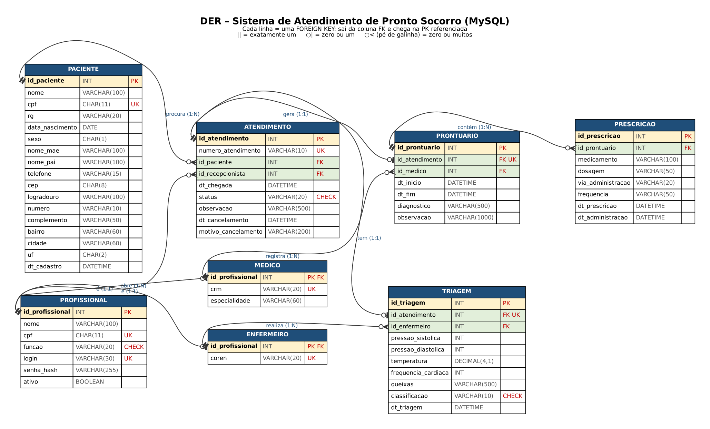

# Banco de Dados

MySQL 8. Modelo com 8 tabelas: paciente, profissional, medico, enfermeiro, atendimento, triagem (com classificação de Manchester), prontuario e prescricao. Duas views: painel do médico e histórico do paciente.

## Execução

1. `01_criacao_tabelas.sql`: recria o banco `pronto_socorro`, as tabelas e as views.
2. `02_dados_iniciais.sql`: insere profissionais, pacientes e alguns atendimentos de teste.
3. `03_consultas_sistema.sql`: comandos usados pelo back-end (referência, não executar inteiro).

## Status do atendimento

`AGUARDANDO_TRIAGEM` → `AGUARDANDO_MEDICO` → `EM_ATENDIMENTO` → `FINALIZADO` (ou `CANCELADO` antes da finalização)
